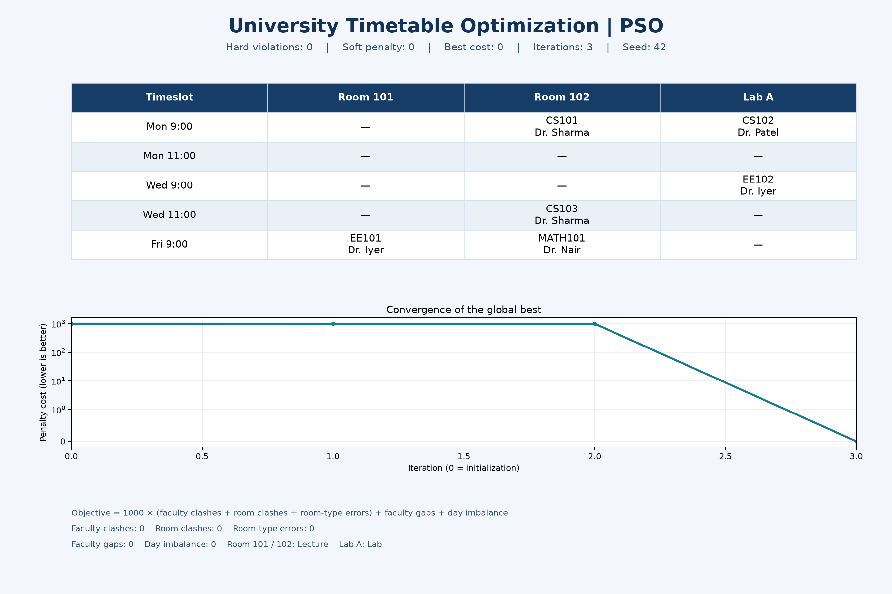

# University Timetable Optimization using PSO

A runnable Particle Swarm Optimization (PSO) program for the university timetable
instance in the original Genetic Algorithm notebook. The original notebook and
its screenshot are preserved.

## Run

```bash
python3 -m venv .venv
source .venv/bin/activate
pip install -r requirements.txt
python3 university_timetable_pso.py
```

The program prints the assignments and saves `output.png` beside the script.
The image contains the timetable, constraint counts, and global-best convergence.

```bash
python3 university_timetable_pso.py --particles 60 --iterations 250 --seed 42 --output output.png
python3 -m unittest -v
```

## Problem and objective

There are six course sessions, four faculty members, two lecture rooms, one lab,
and five timeslots across Monday, Wednesday, and Friday. Each course occurs once.
Faculty assignments and room requirements match the original notebook.

Hard constraints:
- A faculty member cannot teach two courses in the same timeslot.
- A room cannot hold two courses in the same timeslot.
- Each course must use the required room type.

Soft constraints minimize internal gaps in each faculty member's daily schedule
and the squared difference between each day's class count and the target of two.
With the supplied two-period days, the faculty-gap term is always zero; it is
included explicitly in the objective. Student cohorts, capacities, course lengths,
weekly repetition, and availability restrictions are outside this example.

```text
cost = 1000 * (faculty clashes + room clashes + room-type errors)
       + faculty gaps + day imbalance
```

Clashes are counted pairwise. For this fixed instance, soft penalties are below
1000, so hard constraints take priority. The objective is nonnegative; cost zero
is therefore a global optimum. A nonzero result is reported as such; PSO does not
guarantee an optimum for every seed or parameter choice.

## PSO implementation

1. Define one room coordinate and one timeslot coordinate for each course.
2. Initialize 60 particles with random continuous positions and velocities.
3. Clip and round coordinates to decode discrete timetable assignments.
4. Evaluate each schedule and retain personal and global best positions.
5. Update velocity using inertia, cognitive attraction, and social attraction:
   `v = w*v + 1.7*r1*(pbest-x) + 1.7*r2*(gbest-x)`; then update `x = x+v`.
6. Bound velocities to half each coordinate's range and clip positions to bounds.
   Inertia decreases linearly from 0.9 to 0.4 over the iteration budget.
7. Stop at cost zero or after 250 iterations; output the best decoded schedule.

The seed controls NumPy's random generator. With seed 42 and the included defaults,
the committed run reaches **cost 0 with zero hard violations in 3 iterations**.
There are two classes on each day. Convergence includes initialization at iteration 0.


